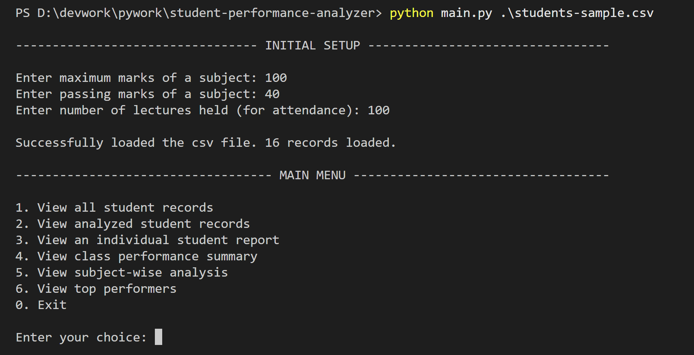
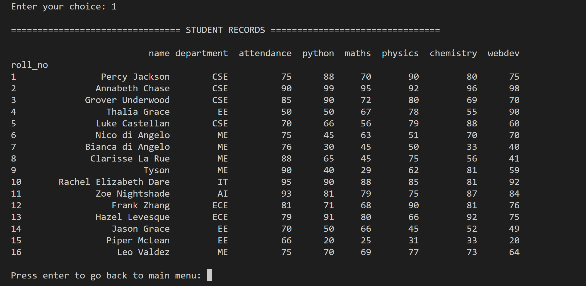
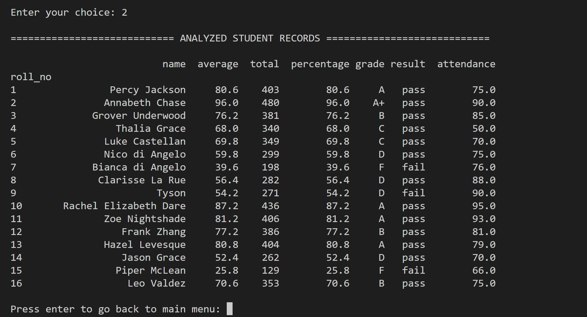
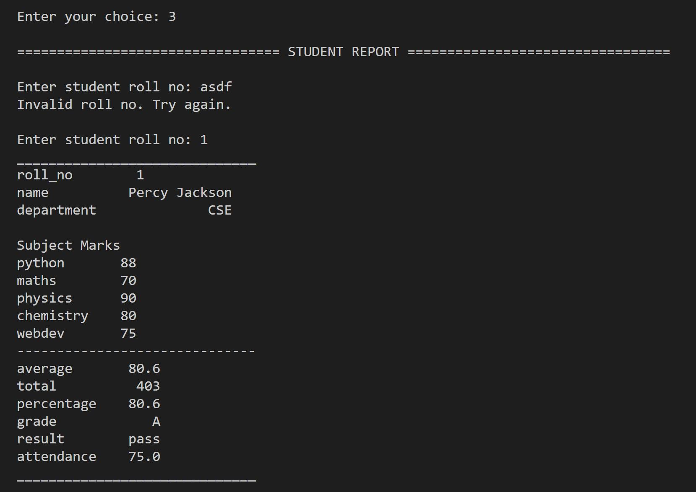
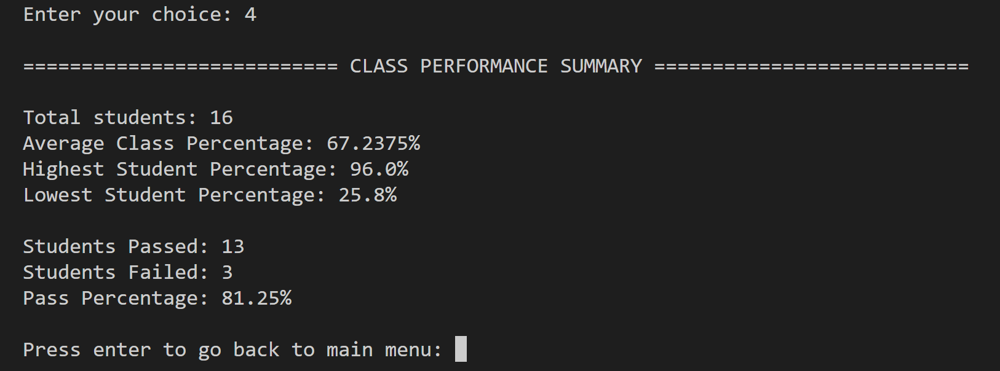
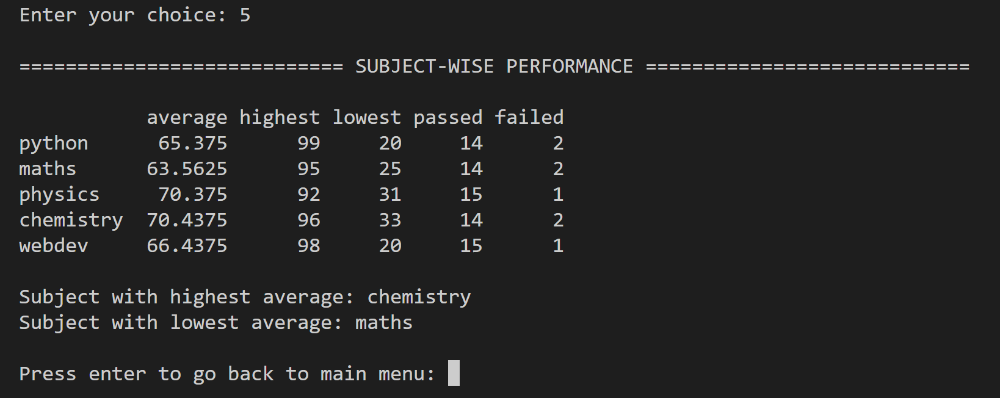
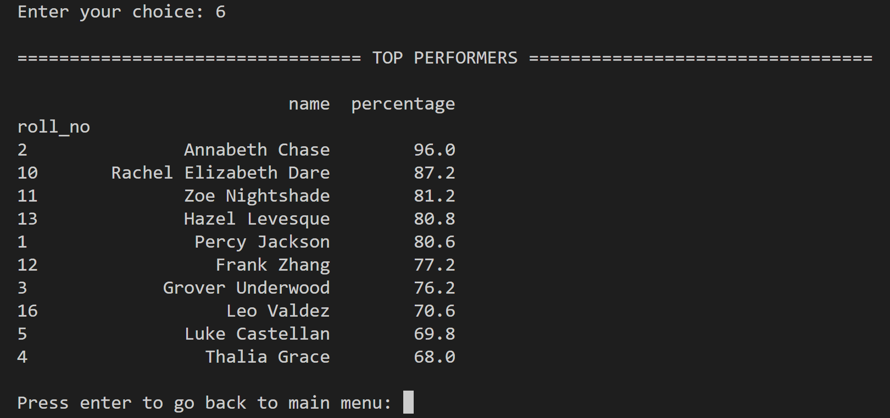

# Student Performance Analytics System

## Project Title and Student Details

- **Project title:** Student Performance Analytics System
- **Program name:** Student Performance Analyzer
- **Developed by:** Deepanshu

## Objective

This project automates the analysis of student performance using Python, Pandas and NumPy. It also calculates total marks, average marks, marks percentage, assigns grades, pass/fail result and attendance percentage. It also provides insights such as overall class performance and subject-wise analysis.

## Technologies Used

This project uses the following technologies:
- **Python:** Implements the program logic, loops, calls the functions from modules and menu-driven interface.
- **NumPy:** Used for efficient calculations and conditional operations.
- **Pandas:** Reads CSV file, stores student records as DataFrame and analyzes the data.

## Dataset Description

- The dataset to be analyzed is expected to be of format: `roll_no, name, attendance, department, <subjects>`
  - `roll_no`: Unique roll number for each student. This is used as index for the pandas dataframe.
  - `name`: Student's name
  - `attendance`: Number of lectures attended.
  - `department`(optional): Department of student.
  - `<subjects>`: Each remaining column represents a subject and contains the student's marks in that subject.
- Refer to `students-sample.csv` for an example.
- Column names are case-insensitive.
- The `roll_no` column can also be named as `roll number`, `rollnumber`, `roll no`, `rollno`.
- Decimal part of attendance values is truncated, because decimal attendance does not make sense.

- The CSV files must satisfy the following validation rules:
  - It has a roll_no column
  - It has an attendance and name column
  - It has at least one subject column
  - It has no missing values in any row
  - Marks and attendance must be numeric and within valid ranges

## Prerequisites and Usage

**Prerequisites:**
- Python 3.10 or later
- Pandas
- NumPy

**Usage**
To run the program in the terminal, run the command:
`python main.py path/to/your/csv/file.csv`

For example: `python main.py students-sample.csv`

## Implementation

Program Workflow:
- **Input:** The user provides a CSV file when running the program from the command line.
- **Initial Setup:** The user is asked to input the maximum marks per subject, passing marks, and total lectures held. This data is later used to calculate the marks percentage, pass/fail, attendance percentage.
- **Data Loading:** Pandas reads the CSV file and loads it into a DataFrame.
- **Data Validation and Cleaning:** The program checks that the file follows the validation rules. It standardizes the column names, removes whitespace from name, roll_no and changes data type of columns.
- **Performance Analysis:** It calculates the average marks, total marks, percentage, grade, result, attendance percentage, and stores the analyzed DataFrame. This analyzed DataFrame is later used to calculate the overall class performance, subject-wise performance and top performers.
- **Menu:** The program then shows the user a 'Main Menu' allowing them to choose an action to be performed.

Program structure:
- `main.py`: coordinates the program's execution. 
- `main.py` uses the following modules:
  - `dataCleaner.py`: validates and cleans the input file's format, data.
  - `recordsAnalyzer.py`: analyses the student record, class performance, subject-wise performance.
  - `choicesManager.py`: Manages menu choices display and selection.
  - `helperFunctions.py`: contains general helper functions.
  
## Key Features

- **View all student records:** Display the original dataset.
- **View analyzed records:** Display the analyzed student performance dataset.
- **View individual student report:** Show a student's performance report using their roll number.
- **Class performance summary:** Displays the total number of students, average, highest, lowest percentage, pass/fail counts and pass percentage.
- **Subject-wise analysis:** Displays each subject's average, highest, lowest marks and pass/fail counts. Also, shows the subject with highest and lowest average.
- **Top performers:** Displays top 10 students ranked by their overall percentage.

### Grading and Passing Criteria

|Percentage|Grade|
|----------|-----|
|[90-100]|A+|
|[80-90)|A|
|[70-80)|B|
|[60-70)|C|
|[50-60)|D|
|[40-50)|E|
|[0-40)|F|

A student passes only if they obtain at least the specified passing marks in **every** subject.

## Sample Output

## Final Outcome

The program converts raw student records into meaningful performance reports, supports individual, class-level and subject-wise analysis, identifies top performers, and detects invalid input data before analysis.

## Challenges and Learning

- Validating inconsistent or incomplete CSV data using Pandas.
- Using Pandas for reading CSV, calculations, selection, filtering and cleaning data.
- Using NumPy for calculations and conditional operations.
- Structuring program into modules.

## Github Repository

Repository: https://github.com/Deepanshu1331/student-performance-analyzer